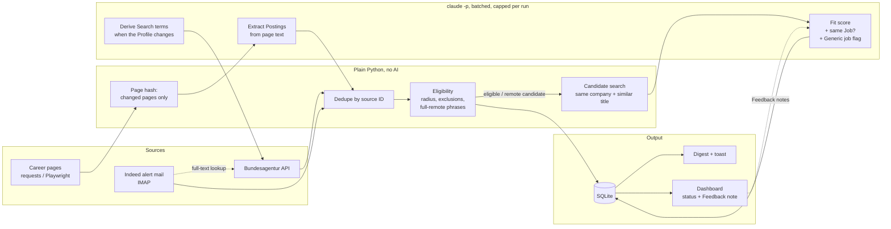

# JobSearch

Daily, mostly automated job discovery for one candidate. It collects postings from the Bundesagentur für Arbeit, Indeed alert mails and company career pages, merges duplicates into real openings, decides with plain rules whether a job is in reach, and keeps everything in a local SQLite database. AI scoring runs through Claude Code on a subscription, with no API costs.

The vocabulary is defined in [CONTEXT.md](CONTEXT.md), the main decisions are in [docs/adr](docs/adr/), and the build order is in [docs/implementation-plan.md](docs/implementation-plan.md).

## How the AI is used

The pipeline is script first: plain Python does everything a rule can decide, and Claude only gets the few steps that need judgment ([ADR 0001](docs/adr/0001-script-first-ai-only-for-judgment.md)). The AI runs headless through `claude -p` on a Claude Pro subscription, so there are no API costs, but every call uses quota that is shared with interactive work. That limit shapes the whole design.

**Status:** All phases (1–9) are built: collection from the Bundesagentur, Indeed alert mails and Target companies' career pages, Search terms derived from the Profile, rule-based Eligibility, Fit scoring with Digest and toast, Job matching with Reopenings, a daily run started at logon, and a local dashboard with Feedback notes.



### Where AI is called

| Step | Model | Input | Output | Phase |
|---|---|---|---|---|
| Fit score for new eligible Jobs (**built**) | Sonnet | Profile, recent Feedback notes, rubric, up to `MAX_SCORED_PER_RUN` Jobs in one call | JSON per Job: tier (★★★/★★/★), German reasoning, matching and missing skills, remote and part-time signals, and for ★ whether it is Sorted out (clearly another field) | 3 |
| Rescoring (by hand only, **built**) | Sonnet | ★ Jobs with status new whose Fit score came from an older scoring prompt, in batches of `MAX_SCORED_PER_RUN` | A new Fit score per Job; the old one is kept | – |
| Same Job across Sources? (**built**) | Sonnet | Candidate pairs found by plain rules | Same Job or not, in the same call as scoring | 4 |
| Generic job flag (**built**) | Sonnet | The Job being scored | Flag that keeps multi-role and recruiter ads out of matching | 4 |
| Extract Postings from career pages (**built**) | Haiku | Visible text of pages whose hash changed, several pages per call | Posting JSON | 8 |
| Find career pages (one-time setup, with web search, **built**) | Sonnet | Company names, and for a recheck what went wrong with the old URL | Career URL, ATS type and render mode, written back for a human to check | 8 |
| Derive Search terms (**built**) | Sonnet | The Profile, only when its hash changes | 5–8 Search terms, used together with the manual ones | 9 |

### Design principles

- **Rules before AI.** Collecting, deduplicating and Eligibility are deterministic. The AI only sees what is left. 
- **Cheap model for mechanical work.** Haiku extracts, Sonnet judges.
- **No browsing in the main loop.** Scoring and extraction run without tools. Python fetches and renders pages itself (Playwright for JavaScript pages) and hands over plain text. The only browsing step is the one-time career page setup, and its result is reviewed by hand.
- **Structured output, checked twice.** Every call passes a JSON schema that the CLI enforces, and the code then checks that every Job in the batch was answered exactly once. Invalid output gets one retry, and quota or login problems raise a clear German error.
- **Extracted Postings must be on the page.** Career page text is untrusted, and the extraction model can invent. Every title and link it returns must appear in the page text it was given; the rest is dropped, logged and counted in the career summary ("verworfen (nicht im Seitentext)").
- **Third-party text is data, not instructions.** Job ads, career pages and fetched web pages can address the model. The prompts keep that text in JSON and say it is data; the model flags text that tries to steer it (`injection_suspected`, a warning in the Digest, the Job is scored as usual). Links are limited in code, whatever the model answers: only http(s) links are stored, and nothing is fetched from local addresses, redirects included. `jobsearch check-injection` measures this with synthetic injected ads.
- **AI failure never blocks collection.** If scoring fails, the run still counts as collected, the Jobs wait as unscored, and the error is stored with the run.
- **Uncertainty is shown, not hidden.** Jobs scored from a short mail snippet are marked low confidence ("geringe Evidenz"). Before scoring, the Daily run looks for the same opening at the Bundesagentur (same company, very similar title, near the same place) and scores on its full text when it finds one. Rule decisions store their reason, so wrong filters can be found.
- **Human in the loop.** The candidate sets a Job status with an optional Feedback note in the dashboard, and recent notes go into the next scoring prompt.
- **AI usage is measured.** Every `claude -p` call, retries included, is stored with its purpose, tokens and API equivalent (the list price the call would cost through the API). `status` and the Digest show a line, `jobsearch eval --usage` the details and the API equivalent per scored Job, per ★★★/★★ Job and per career page. It is neither a real cost nor a share of the subscription quota, whose limit is not published in tokens and which also covers interactive use.
- **Tests never call the AI.** `ai.py` is the only module that runs `claude -p`, and tests replace it with a fake.

## Setup

```
python -m venv .venv
.venv\Scripts\python -m pip install -e ".[dev]"
.venv\Scripts\python -m jobsearch init
```

`init` creates `data/`, the database, `.env` and the `private/` files from the examples. Then fill in:

- `.env`: home location and radii, and later the profile path and mail credentials
- `private/companies.csv`: Target companies, with aliases for the names they use in job ads
- `private/exclusions.txt`: title words that rule a job out (internships, theses, ...)
- `private/search_terms.txt`: your own Search terms. Once `PROFILE_PATH` is set, the daily run adds 5–8 terms derived from the Profile, and derives them again whenever the Profile changes. A line `-term` switches a term off, derived or not. `jobsearch status` lists the active ones.
- `private/found_elsewhere.csv` (optional): openings you found outside the tool (`company,title,url,found_on`). `jobsearch eval --funnel` shows where the pipeline lost each one.

`init` also downloads the GeoNames postal codes for Germany and Switzerland into `data/geo/`, used to place jobs that come with a place name only. They are © GeoNames, licensed under [CC BY 4.0](https://creativecommons.org/licenses/by/4.0/).

`.env`, `private/` and `data/` are gitignored and never leave your machine.

### Guardrails for Claude Code

`.claude/settings.json` registers a `PreToolUse` hook (`python -m jobsearch.guard profile`) that keeps Claude Code from changing the Profile: any `Edit`, `Write`, `MultiEdit` or `NotebookEdit` on the Profile or anything in its folder is blocked. It reads `PROFILE_PATH` at run time, so the checked-in settings hold no personal path; a `PROFILE_PATH` in the environment wins over `.env`. Shell commands (`Bash`, `PowerShell`) that name the Profile's folder are blocked too, but that is only a string check: a command that builds the path another way, or uses an alias such as Git Bash's `/tmp`, gets through. If the check itself fails on a file write, the write is blocked. The hook needs the venv at `.venv`; Claude Code reads hook settings at session start.

### Commit check for personal data

`init` runs `git config core.hooksPath .githooks`, which switches on two tracked git hooks. `pre-commit` (`python -m jobsearch.guard staged`) scans the lines and file names a commit adds, `commit-msg` scans the message. They look for the values of `PROFILE_PATH`, `HOME_LOCATION`, `HOME_LAT`, `HOME_LON` and the `IMAP_*` settings, the lines of `private/exclusions.txt` and `private/search_terms.txt`, the names, aliases, locations and career URLs in `private/companies.csv`, and the derived Search terms in the database. Matching is case-insensitive, on whole words, for values of four characters or more; values that `private.example/` also uses are generic and skipped. On a hit the commit is refused with file, line and kind of value (the password stays hidden). This covers commits by hand and by Claude Code alike.

A term you accept in the repo, for example a common technical word that is also one of your Search terms, goes into `private/allowed_terms.txt`. `git commit --no-verify` skips the check on purpose.

## Usage

```
.venv\Scripts\python -m jobsearch daily    # collect, check Eligibility, fetch descriptions, score, Digest
.venv\Scripts\python -m jobsearch score    # score only (--limit N for a cheap test)
.venv\Scripts\python -m jobsearch rescore  # rate ★ Jobs from an older scoring prompt again (1 AI call per batch)
.venv\Scripts\python -m jobsearch status   # counts and the last runs
.venv\Scripts\python -m jobsearch dashboard # local web page: Jobs, details, Job status and notes
.venv\Scripts\python -m jobsearch career-setup [--recheck]  # find career pages with web search (one time)
.venv\Scripts\python -m jobsearch career-scan  # check career pages now (otherwise weekly inside daily)
.venv\Scripts\python -m jobsearch eval [--since D] [--until D] [--split D]  # metrics per stage and Search term
.venv\Scripts\python -m jobsearch eval --scores [--by model|profile|prompt|month]  # Fit score against Job status
.venv\Scripts\python -m jobsearch eval --funnel  # where openings found elsewhere got lost
.venv\Scripts\python -m jobsearch eval --changes  # when settings changed (prompt, Profile, Search terms, ...)
.venv\Scripts\python -m jobsearch eval --usage  # AI usage: tokens and API equivalent per day, purpose and model
.venv\Scripts\python -m jobsearch report [--dry-run]  # Weekly report now (1 AI call; otherwise weekly inside daily)
.venv\Scripts\python -m jobsearch market [--since D] [--until D] [--regroup]  # Market report (up to 3 AI calls)
.venv\Scripts\python -m jobsearch check-injection  # prompts against injected instructions (2 AI calls)
.venv\Scripts\python -m jobsearch install-task    # run automatically 5 minutes after each logon
.venv\Scripts\python -m jobsearch uninstall-task  # remove that task again
.venv\Scripts\python -m pytest             # tests, never touch the network
```

The Weekly report is made by the Daily run once a week (`REPORT_INTERVAL_DAYS`), after scoring. Plain Python computes the pipeline's metrics (per stage, per active Search term, Fit score against Job status, found-elsewhere openings), each with an ID and the count it rests on; one AI call reads them and recommends up to five changes, each citing metric IDs. The AI writes no numbers: the report shows the values from the database, and a Recommendation whose text has a number its evidence does not back, that rests on too few Jobs, or whose target does not fit (a term that is not active, a word already excluded) is dropped and counted. The report lands in `data/reports/YYYY-Www.md`, on the dashboard page "Wochenbericht", and in a toast.

The Market report looks across all scored Jobs. Active companies (3 or more Jobs in reach within 90 days, or a Reopening, without Generic jobs) come from plain Python, with a hint for those not yet on the Target company list. The skill texts of the ★★ and ★★★ Fit scores are free text, so `jobsearch market` first sorts new ones into lasting Skill groups with a few Haiku calls (checked by index in code), then counts per group how many Jobs miss it or show it. It runs only by hand and writes no file; the dashboard page "Markt" shows the same without AI and lists each group's original texts, so a wrong grouping is easy to spot (`--regroup` starts over).

The dashboard runs on `127.0.0.1` only and opens in the browser. It lists the Jobs with filters, marks those that are new since the last visit, and shows the full description, all Postings and the score reasoning per Job. Setting a Job status there can carry a Feedback note, and recent notes go into the next scoring prompt.

A ★ Job the scoring model marks as clearly outside the candidate's field is Sorted out: it keeps its Fit score and reasoning, but the dashboard list hides it while its Job status is new (the filter "aussortiert" shows them), the Market report leaves it out, and the Digest only counts it. Nothing is deleted. After a change to the scoring prompt, `jobsearch rescore` rates the open ★ Jobs again in one go; it adds a newer Fit score, never touches Eligibility or matching, and stops at a failing batch so the next call continues. Reports count each Job once, by its newest Fit score; `eval --scores --by prompt` puts the old and the new judgment side by side.

The career scan reads `private/companies.csv`. `career-setup` fills in missing career page URLs with a web search and writes them back for you to check; `--recheck` looks again at pages that failed or listed nothing. Pages that only show jobs after JavaScript need the optional browser: `pip install -e ".[browser]"` and `playwright install chromium`.

`install-task` registers a Windows Task Scheduler task for the current user. It starts `jobsearch run` without a console window, which does the Daily run at most once per day, catches up missed days, and shows problems as a toast. Logs are in `data/logs/`.

## How Eligibility works

- Distances are straight-line from home. Within `RADIUS_KM` is in reach, and within `RADIUS_TARGET_COMPANY_KM` for Target companies.
- A title containing a word from the exclusion list is out.
- Jobs outside the radius are only kept when the posting allows home office *and* the description contains a full-remote phrase ("100% remote", "ortsunabhängig", ...). Those stay `unclear` until the AI scoring confirms them.
- An alert mail Job whose place is only a country came in through the alert's remote filter and counts as remote. Without a full text it is kept on that filter (a snippet rarely names a remote phrase), and the AI drops it only when it finds the ad hybrid or on-site.
- An alert mail Job whose place cannot be located (a region, for example) stays `unclear` unless the full-text lookup finds it at the Bundesagentur; then it takes that place and is decided again.

Every decision is stored with its reason, including the ineligible ones.
